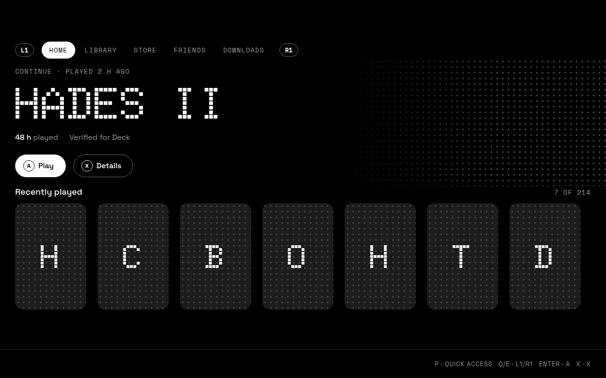
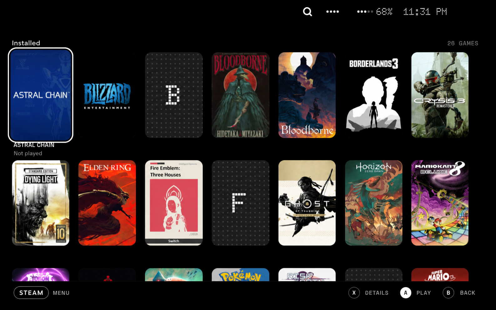
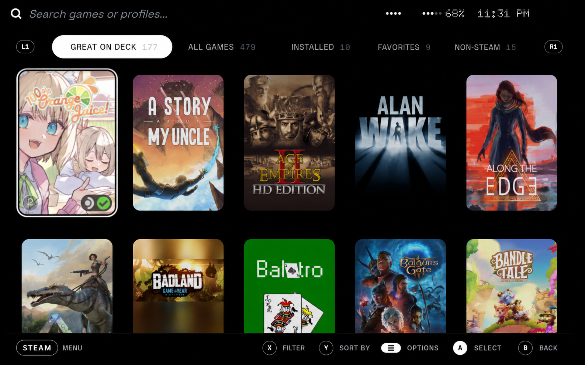
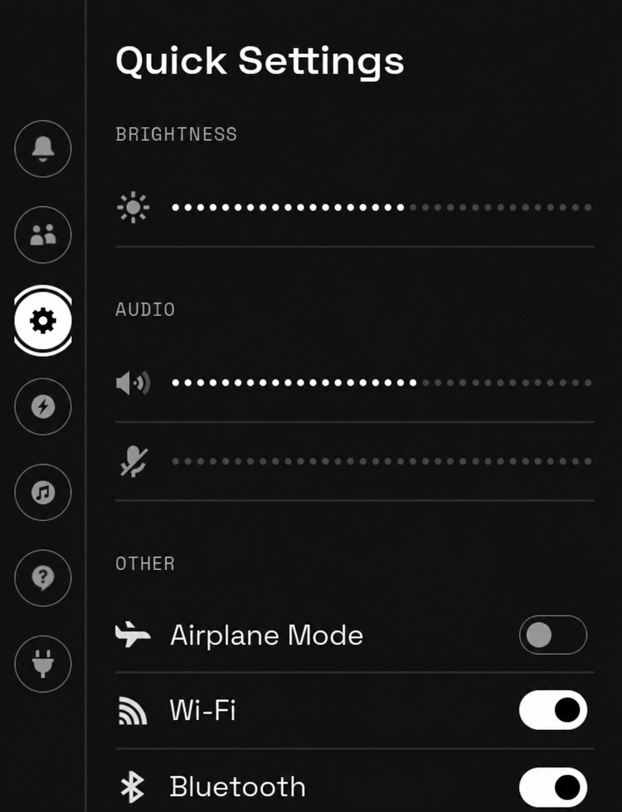

# Void Deck

A Steam Deck interface made of dots, light and void. A [Decky Loader](https://decky.xyz) plugin that restyles
the whole Steam interface (Game Mode): pure black backgrounds, dot-matrix typography and a custom Home screen,
designed to be driven with the controller.



## What it changes

**A custom Home screen.** The game you were playing, front and center in dot-matrix type, with its playtime and
Steam Deck compatibility. Below it, your recently played games and every installed game — including non-Steam
ones such as emulators or other stores. A plays, X opens the details.

**Black and white covers.** The game covers — on the Home screen and in the Library — stay in monochrome until
you point at them. The one under the cursor shows its real colors, so the grid reads as one picture and the
game you are looking at stands out.





**The whole Steam interface.** The Library, main menu, top and bottom bars and Quick Access all share the same
language: pure black, Space Grotesk for text, Space Mono for labels and Doto (dot matrix) for numbers. Battery and
Wi-Fi in the top bar become dot meters, and the battery turns red below 20 %.

| Quick Access | Main menu |
|---|---|
|  |  |

Brightness and volume are shown as rows of dots and toggles as pills, but they work exactly as before: Void Deck
only changes how Steam looks, never how it works.

**The on-screen keyboard.** It joins the same language: a black panel of square keys with hairline borders, dot-matrix
letters, Space Mono for the modifier words and a dot-grid text line. The focused key inverts to solid ink, so you
always know where you are typing.

## Installation

You need [Decky Loader](https://decky.xyz) installed on your Steam Deck.

1. Download `VoidDeck-v1.1.1.zip` from the [v1.1.1 release](https://github.com/endoflineservice/VoidDeck/releases/tag/v1.1.1), or copy its direct URL:
   `https://github.com/endoflineservice/VoidDeck/releases/download/v1.1.1/VoidDeck-v1.1.1.zip`
2. On the Deck, in Game Mode, open Quick Access (the `···` button) → the **Decky** tab (plug icon) → **⚙**.
3. Under **General**, turn on **Developer mode**.
4. In the new **Developer** section, choose one of:
   - **Install Plugin from URL**: paste the link to the release `.zip` (right-click → copy link on the Releases
     page). This is the easiest way: no need to copy files to the Deck.
   - **Install Plugin from ZIP File**: pick the `.zip` if it is already on the Deck (for example, downloaded in
     Desktop Mode to your Downloads folder).
5. Confirm the installation. Void Deck applies immediately and shows up in the Decky tab.

**Updating:** repeat the steps with the new version's `.zip`; it replaces the previous one.

**Uninstalling:** Decky → ⚙ → **Plugins** → Void Deck → **Uninstall**. Steam goes back to its original look
right away.

## Settings

In Quick Access, Decky tab → **Void Deck**:

- **Global skin**: the Void Deck style across the whole Steam interface.
- **Home screen**: replaces Steam's Home with the Void Deck one.
- **Light theme**: inverted colors for outdoor use.
- **Language**: select English (the default) or Spanish. The selector is ready for more languages in future releases.
- **Reset to defaults**: restore English, the dark theme and both screens enabled.
- **Version**: shows the installed plugin version and opens the latest release notes.

Each part can be turned off on its own. If a Steam update breaks something, turn that part off and the rest keeps
working.

## Commands

Run these from a clone of the repository with Node 22+ and pnpm installed:

```sh
pnpm install        # install project dependencies
pnpm preview        # start the browser preview at http://localhost:5173
pnpm typecheck      # check TypeScript without writing output
pnpm build          # build dist/index.js
pnpm package        # build and create out/VoidDeck-v<version>.zip
pnpm deck           # build and deploy to a configured Steam Deck over SSH
pnpm deck:setup     # one-time setup for password-free deployment
pnpm deck:log       # show installed plugins and the Decky log
```

For Deck deployment, copy `.env.deck.example` to `.env.deck`, set `DECK_HOST`, then run `pnpm deck:setup` once.
See [the development guide](docs/DEVELOPMENT.md) for the full setup and publishing instructions.

> Void Deck is an independent project, not affiliated with Valve or Steam. Steam changes its interface often:
> after an update, some screen may look half-styled until a new version of the plugin is released.

## How it was made

Void Deck was developed with AI assistance (Claude). The design, direction and every release are mine: as a
software engineer, I test each change on my own Steam Deck and review the code before it ships.

## License

[GPL-3.0](LICENSE). The bundled typefaces (Doto, Space Grotesk and Space Mono) are distributed under the
SIL Open Font License 1.1: see [`third_party/fonts`](third_party/fonts). Controller prompt assets are from
[Kenney Input Prompts](https://kenney.nl/assets/input-prompts), licensed CC0; see
[`third_party/KENNEY-INPUT-PROMPTS-CC0.txt`](third_party/KENNEY-INPUT-PROMPTS-CC0.txt).

## Built with

Void Deck was built with AI assistance from Claude, DeepSeek Flash, MiniMax M3.1 Flash, Codex SOL and Big Pickle.
